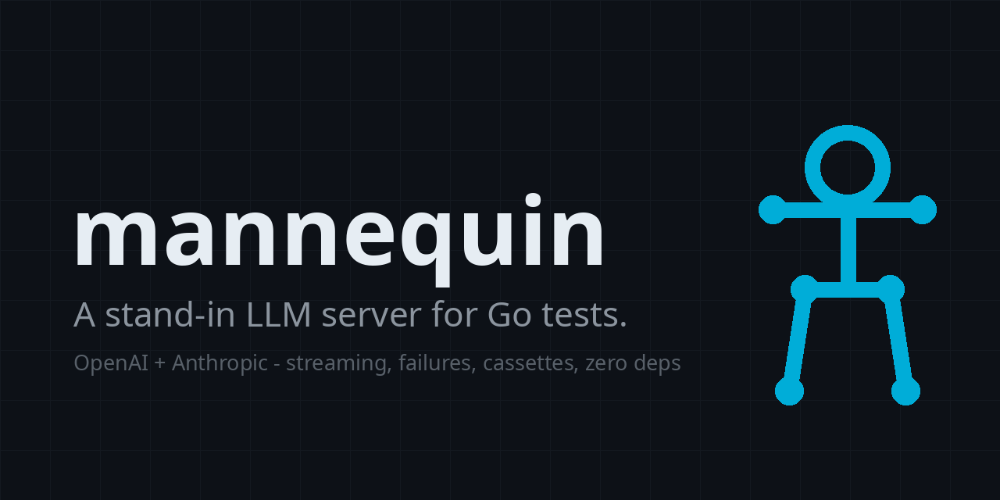
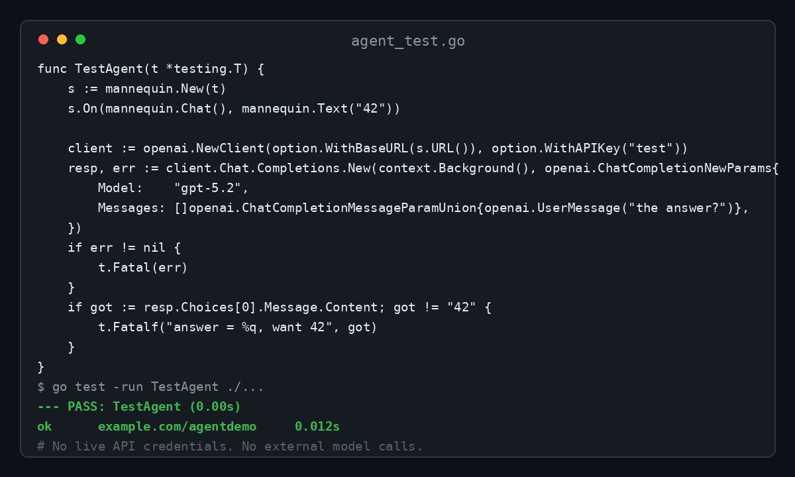

**Your agent's tests hit the real LLM API? That's slow, flaky, and bills you for every CI run.**

mannequin is a stand-in LLM server for Go tests. Point your OpenAI or Anthropic SDK at it and program the responses: fixed text, streamed chunks, injected failures, or recorded cassettes. No live API credentials. No external model calls.

```go
func TestAgent(t *testing.T) {
    s := mannequin.New(t)
    s.On(mannequin.Chat(), mannequin.Text("42"))

    client := openai.NewClient(option.WithBaseURL(s.URL()), option.WithAPIKey("test"))
    resp, err := client.Chat.Completions.New(context.Background(), openai.ChatCompletionNewParams{
        Model:    "gpt-5.2",
        Messages: []openai.ChatCompletionMessageParamUnion{openai.UserMessage("the answer?")},
    })
    if err != nil {
        t.Fatal(err)
    }
    if got := resp.Choices[0].Message.Content; got != "42" {
        t.Fatalf("answer = %q, want 42", got)
    }
}
```

This exact test, executed against the real openai-go SDK:



## What you get

- OpenAI `/v1/chat/completions` and Anthropic `/v1/messages` endpoints
- Fixed-text and SSE streaming responses (chunk by chunk, the way agents actually read)
- Failure injection: real status codes (429 with `Retry-After`, 500, any other), malformed payloads via custom bodies, and mid-stream cuts for when the provider drops
- Record/replay cassettes with credential safety built in (details below)
- Matchers by endpoint and request-body content, so one server plays many models
- Zero dependencies. `go get` and you're done

## Install

With your coding agent, paste:

```
Add github.com/ofershap/mannequin to my project and convert my LLM tests to use it instead of the live API.
```

By hand:

```bash
go get github.com/ofershap/mannequin@latest
```

## Programmed responses

```go
s := mannequin.New(t)

// Fixed answer, shaped correctly for whichever endpoint is called.
s.On(mannequin.Chat(), mannequin.Text("Hello from the stand-in"))
s.On(mannequin.Messages(), mannequin.Text("Bonjour"))

// Match only some requests.
s.On(mannequin.BodyContains(mannequin.Chat(), "gpt-5.2"), mannequin.Text("new model"))

// Streaming, chunk by chunk.
s.On(mannequin.Chat(), mannequin.Stream("Hello, ", "world", "!"))

// Failure paths: test your retry logic for real.
s.Fail(429).WithRetryAfter(time.Second)

// Provider dies mid-stream: partial chunks, then the connection drops.
s.On(mannequin.Chat(), mannequin.Cut("partial", " answer"))
```

Requests that match no rule get a 404 with a JSON error naming the unmatched call, so a missing fixture fails loudly instead of hanging your suite.

## Record and replay

Record real exchanges once, replay them forever:

```go
s := mannequin.New(t)
s.Record("testdata/cassettes/pricing.json")
s.On(mannequin.Chat(), mannequin.Text("...")) // or proxy code you wrap
```

Replay in CI without any key:

```go
s := mannequin.New(t)
replay, err := mannequin.Replay("testdata/cassettes/pricing.json")
if err != nil {
    t.Fatal(err)
}
s.On(mannequin.Chat(), replay)
```

Cassette safety, stated plainly: request headers are never recorded, so `Authorization` and `x-api-key` cannot end up in a cassette. Request and response bodies are recorded verbatim, and bodies can contain private prompts or outputs. Pass a scrub function to `Record` to censor bodies before they are stored, prefer synthetic fixtures, and review cassettes before committing them. Streaming responses are never recorded.

## Before and after

The alternative most Go projects use today is a hand-rolled `httptest` server per test file. A typical version of that is 30-60 lines of boilerplate per endpoint, no streaming, no cassette format, and a silent credential leak waiting to happen. mannequin is the same idea, finished.

<details>
<summary>Q&A</summary>

**How do I mock the OpenAI API in Go tests?**
Create a mannequin server with `mannequin.New(t)`, program responses with `s.On(mannequin.Chat(), ...)`, and point the official SDK at it with `option.WithBaseURL(s.URL())`. No interface refactoring, no codegen.

**How do I mock the Anthropic API in Go tests?**
Same server. `s.On(mannequin.Messages(), ...)` answers `/v1/messages` with correctly shaped Anthropic responses, streaming included.

**How do I test LLM retry and rate-limit handling?**
`s.Fail(429).WithRetryAfter(time.Second)` makes every request fail the way a real rate limit does. `s.Fail(500)` and custom bodies cover the rest.

**Does it support streaming / SSE?**
Yes. `mannequin.Stream("chunk1", "chunk2")` emits a real SSE stream per chunk, in both OpenAI and Anthropic event formats.

**How do I test a provider dropping mid-stream?**
`mannequin.Cut("partial", " answer")` sends the opening events and your chunks, then the connection dies: no terminating event, no clean end of body. The SDK surfaces a stream error after the partial chunks, so you can test recovery for real.

**Can I record real API calls and replay them in CI?**
Yes. `s.Record(path)` writes a JSON cassette; `mannequin.Replay(path)` serves it back. Headers are never recorded; scrub hooks censor bodies.

**Which SDK versions does it work with?**
The compatibility suite pins and tests specific versions (see `compat/`); the wire formats it implements are the stable chat-completions and messages APIs.

</details>

## Scope

The public API is intentionally small and the supported endpoints are exactly the two listed above; more arrive as real projects need them.

---

More projects: [gitshow](https://github.com/ofershap/gitshow) · [real-browser-mcp](https://github.com/ofershap/real-browser-mcp) · [cursor-usage-tracker](https://github.com/ofershap/cursor-usage-tracker) · [mcp-server-markdown](https://github.com/ofershap/mcp-server-markdown) · [readme-builder](https://github.com/ofershap/readme-builder) · [grok-bot-skills](https://github.com/ofershap/grok-bot-skills) · [mashov-parent-brief](https://github.com/ofershap/mashov-parent-brief)

Built by [Ofer Shapira](https://ofershap.github.io). MIT license.
